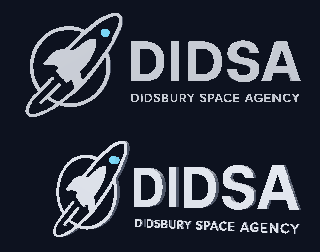
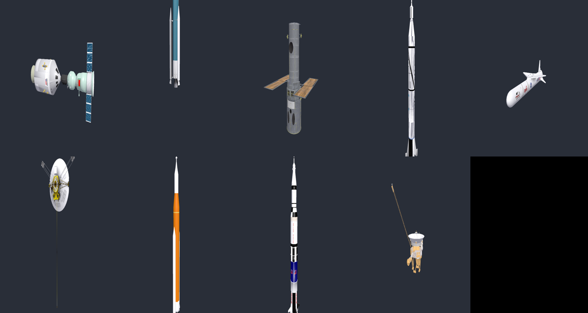

# Landing: scope

**Status:** L1 to L3 built (20 Oct 2026, headless- and render-tested; not checked on a headset: see [What was built](#what-was-built-l1-to-l3)). L0 and L4 to L7 are not started. The demo files it needs are in [`../demo/`](../demo/) and verified to
load and pack (see [What was checked](#what-was-checked)). Branch `claude/vr-landing-feature-scope-kspao7`.

**Goal:** a sideloaded APK that you can hand to a friend. They put the headset on, see what the app is, can do something impressive
with no server, and you can connect it to your server in seconds without typing on a VR keyboard.

## What happens today

- With no `secrets.cfg` (every APK you give away): the user lands in an empty room. The only message ("No backend configured...")
  goes to the console, not the headset, so they see nothing at all.
- With `secrets.cfg`: the app imports `res://assembly.didsa` on start. That file is not in the APK unless your export filter includes
  it, and `secrets.cfg` is read from `res://`, which is read-only in an APK, so nothing can be changed in the headset.

## What the user sees

The landing is a state of the existing world (`main.tscn`), not a separate scene, so leaving it costs no load and the wrist tablet, wheel
and locomotion all keep working. It shows on every launch (Settings: "Show the landing on start", default on) and comes back from a
**Home** tile on the wrist tablet and the tool wheel.

```
                       [ rocket garden, 1:1, 40-60 m away ]
                         Saturn V  SLS  Delta II  Jupiter-C ...

          [ DIDSA logo, 3D, ~1.2 m wide, 2.5 m ahead, eye height ]
               "Design and assemble parts at full size."

   [ tips reel ]        [ launcher panel, arm's reach ]        [ connection pill ]
   cycles every 8 s     big tiles, laser + trigger             "Offline: demo models"
                                                               "Connected: Workshop PC"
```

1. **Logo** (the hero). The DIDSA emblem and wordmark in 3D, white with the blue porthole, gently animated: the rocket glides a little
   along the orbit band, the porthole pulses (both frozen by Settings > Comfort > Reduce motion). See [Logo](#logo).
2. **One line of introduction** under it, and a "What is this?" tile that opens a short panel: VR client for DIDSA-CAD; your parts at
   full size; the same files as the flat app.
3. **Launcher panel**: the actions below, on a `diegetic_panel.gd` window like the others (carry it by its handle).
4. **Tips reel**: see [Tips](#tips).
5. **Rocket garden**: the demo rockets standing at true size on the ground behind the logo, each with a name plate and its height.
   A 110 m Saturn V is the single most convincing thing to show a first-time visitor. They are scenery until picked (see below).
6. **Connection pill**: which server, or "Offline", and a tap opens Servers.

## Launcher actions

| Tile | What it does | Needs a server | Builds on |
|---|---|---|---|
| **Continue** | Reopens the last file (name and a thumbnail) | Native file: yes; glb: no | new `user://recent.cfg`; `load_model_file()` |
| **Open...** | The tablet's Files page, at the landing | Depends on file | existing Files page |
| **New assembly** | Empty assembly, then the usual workspace | Yes | existing `new_document` |
| **Demo models** | Grid of rockets and spacecraft with thumbnails. Pick one: **Full size** (stands it in front of you) or **On the desk** (1:50 on a plinth at waist height, so it can be grabbed and turned). | No | `load_glb_file()`; `demo/` |
| **Demo assemblies** | The table, plate and peg. Greyed with "Needs a server" when offline. | Yes | `open_native_file()`; `demo/assemblies/` |
| **Servers** | Add (scan a QR code), list, test, pick, forget. See [Adding a server](#adding-a-server). | n/a | new |
| **Tour** (suggested) | Two minutes, offline, on a demo rocket: grab it, two-hand scale it, open the wheel, teleport. Each step waits for the action. | No | `wrist_hint.gd` |
| **Mixed reality** (suggested) | Passthrough on or off. On a standalone Quest this also needs the OpenXR Vendors plugin, which is not in the project yet. | No | `environment_manager.gd` |
| **Settings** | Comfort first (seated or standing, snap angle, reduce motion), then the existing Settings page | No | existing page |
| **About** | Version, credits and licences ([`../demo/CREDITS.md`](../demo/CREDITS.md)). Required: the SLS model is CC BY. | No | new |

Suggested later: **What's new** (the CHANGELOG's last entry), **Recent** (more than one file), **Quit**.

## Adding a server

### Where servers are kept

New file `user://servers.cfg`: a list of `{name, url, api_key, document_session, relay_url, relay_api_key}` and which one is current.
`res://secrets.cfg` stays as a developer override (read first, shown as "From secrets.cfg"). `user://` is writable on the Quest and
survives reinstalling over the top. Every `configure_backend()` call in `main.gd` then runs again when the server changes, without a
restart; this needs checking because today it happens once in `_ready()`.

### QR code: viable, and probably without a plugin

You point the headset at a QR code on your PC or phone screen (in passthrough), it reads the server's address and key, and asks
"Connect to *Workshop PC*?".

**Route A, recommended: OpenXR marker tracking, built into Godot.** Godot 4.7.2 has OpenXR spatial-entity marker tracking in core.
The classes exist in the CI build (checked here): `OpenXRSpatialMarkerTrackingCapability.is_qrcode_supported()`, and
`OpenXRMarkerTracker.get_marker_data()`, which returns the decoded text. It is switched on with project settings
`xr/openxr/extensions/spatial_entity/enabled`, `.../enable_marker_tracking` and `.../enable_builtin_marker_tracking`. The headset's
runtime finds and decodes the code, so there is no camera access, no decoder and no addon in this project. It also gives the code's
position, so the "Connect?" card can appear on top of your screen. **Unverified:** a forum report says QR tracking works on a Quest 3
with Horizon OS v83 and Godot 4.6, and that it did not with 4.5. Nothing has been run on a headset here. Which Android permission it
needs (probably the spatial-data / scene permission) and whether passthrough must be on are also unknown.

**Route B, fallback: the Passthrough Camera API** (possible now that custom builds are allowed). Quest 3 and 3S, Horizon OS v74 or later: the forward cameras through Android Camera2
(`android.permission.CAMERA` and `horizonos.permission.HEADSET_CAMERA`, up to 1280x960 at 30 fps, enough for a QR code filling part
of a monitor). Decoding needs ZXing in a small Kotlin Godot Android plugin, so this breaks the "no addons" rule and needs a custom
Gradle build. Meta's QuestCameraKit has a ZXing QR sample to follow.

**Quest 2:** neither route (no colour camera access). It falls back to the options below.

**The QR code itself** is shown by the DIDSA-CAD flat app: **built** (20 Oct 2026), see DIDSA-CAD `docs/vr-headset-pairing.md`.

- Where: the connection screen's **Connect a VR headset** button, and File > **Connect a VR headset...**.
- On tap it checks first, and shows the code only if nothing fails: a server is set; its address is one a headset can reach (it
  refuses the emulator alias, link-local addresses and `http://` on the internet; `http://` on the local network passes with a
  warning, as do `.local`, Tailscale and a private `https://` address); `GET /health` answers with the key; and the server has the endpoints this app needs
  (read from `/openapi.json`; a missing Mates / Measure / Appearance / Scenes route is a warning, since only that tool is lost).
- **The phone's own server** (Server Management's Termux backend, `http://127.0.0.1:8000`) pairs too: turn on Server Management's
  **Let VR headsets on this Wi-Fi connect** and Restart, and the code carries the phone's Wi-Fi address (`http://192.168.x.y:8000`),
  checked there before it is shown. The headset must be on the same Wi-Fi (or the phone's hotspot), and the phone must stay awake.
- Contents: `didsa-vr:1?n=<name>&u=<url>&k=<key>`, each value percent-encoded; `n` is the host name. Reserved, optional: `s=`
  (document session), `r=` / `rk=` (browser relay). The headset must refuse anything that does not start `didsa-vr:1?`, and `http://` to
  anything but a private (local-network) address.
- **Security:** version 1 carries the backend's single `CAD_API_KEY`, so anyone who photographs the screen has it. The code appears
  only on request and hides itself after 60 s. Version 2 (backend work): a short-lived pairing token exchanged once for a per-device
  key you can revoke.
- Not built: the backend printing the code in its terminal on start (for when the flat app is not open).

### Without QR

1. **Pre-load the headset** (best for a demo you set up yourself): `adb push servers.cfg /sdcard/Android/data/<package>/files/servers.cfg`
   (that folder is `user://`). No typing at all. Document the command in the README.
2. **Typed**, as the last resort: URL and key on the existing full keyboard, with "https://" pre-filled and a **Test** button.
3. **Later, LAN discovery**: the headset broadcasts, the server answers, you press Allow on the PC. No QR and no typing. An `http://`
   LAN address needs the network security config from step L0. Not for the first version.

For handing the APK to friends none of this matters: they use the demo models offline.

### Plain http on the Quest

This repo has said "Android blocks cleartext HTTP" since the start, but the status log records it as never tried. Android's rule is
enforced by its Java networking stack (`HttpURLConnection`, OkHttp, WebView); Android's own `NetworkSecurityPolicy` documentation
says the socket API is not expected to honour it. Godot's `HTTPRequest` is native code on its own sockets, so `http://` to a LAN
server very likely works on the Quest already. **First headset test:** connect to a LAN `http://` server (the phone's server, or a PC).
If it works, no network security config is needed and step L0 is only for the Vendors plugin; if it fails, DIDSA-CAD's
`HeadsetPairing.headsetAllowsLanHttp` goes false until L0 adds the config.

## Tips

A reel of one-line hints beside the launcher: icon, a short title, one sentence, and (later) the controller drawn with the button lit.
Changes every 8 s with a fade; previous / pause / next buttons; Settings: "Show tips". The list is data (`scripts/landing/tips.gd`, a
const array), so adding a tip is one line. Later: the same list on the wrist when a tool has not been used yet.

First draft, from the README's Controls table (check each against `controller.gd` before shipping):

1. **Grab anything.** Grip on a part takes it where you hold it. Grip on empty space takes the whole model.
2. **Two hands to scale.** Grip with both hands on empty space, then pull apart to enlarge, push together to shrink.
3. **Exact scale.** Click the right thumbstick to type a scale, for example 1 for full size.
4. **The tool wheel.** Hold right trigger and grip together, move towards a tile, let go to choose.
5. **Walk, turn, teleport.** Left stick walks, right stick left / right turns, push it forward and point at the floor to teleport.
6. **Faster walking.** The travel-speed slider on the tablet goes up to 30 m/s, handy beside a 110 m rocket.
7. **Your wrist tablet.** Point the laser at your left wrist icon and pull the trigger.
8. **Select a part.** Right laser and trigger turns it yellow; the right stick then turns it.
9. **Undo.** Every move and change can be undone from the tablet or the wheel.
10. **Paint.** The Appearance tool: click to paint a body, hold to choose face, part or the whole assembly.
11. **Cut it open.** The Section tool slices the model so you can see inside.
12. **Measure.** Pick two faces, edges or corners to read the distance between them.
13. **Mate parts.** Mates join faces, edges and corners; Relax lets you try moves and put everything back.
14. **Rooms.** Open a sub-assembly in its own glass room and resize it by its corners.
15. **Scenes.** Save a pose of the whole assembly and show it again later.
16. **Mixed reality.** Turn on passthrough to put your parts on your real desk.
17. **Same files as DIDSA-CAD.** Anything saved here opens in the flat app, and the other way round.

## Logo

Built as an asset (20 Oct 2026): traced from the owner's 1024 x 1024 artwork, so it matches the original exactly, wordmark included.



- `ui/logo/didsa_logo.svg`: the vector logo (potrace), in the artwork's black and blue. Rasterised beside the source image it is the
  same shape.
- `ui/logo/didsa_logo.glb`: the SVG's shapes extruded (holes kept, earcut), 1.2 m wide, facing +Z, one node per part
  (`Emblem`, `Porthole`, `Wordmark`, `Tagline`) so the landing can animate the porthole's pulse; near-white `Ink` and an emissive
  blue `Accent`, for a dark room. About 27,000 triangles. Loads as a normal Godot scene (`load("res://ui/logo/didsa_logo.glb")`).
- `icon.svg`, the APK launcher icon, is now the emblem on a dark square (it was a placeholder triangle).
- How to redo it: `ui/logo/source/README.md` (the source image, `make_masks.py`, `trace_logo.mjs`; not exported).
- The emblem traces as one connected shape (planet ring, orbit band, rocket and exhaust touch), so the rocket cannot move along the
  orbit by itself; the idle animation is the porthole's pulse and a slow sway of the whole logo. Splitting the rocket out would
  mean cutting the shape by hand.

## Demo models

All 1:1 in metres, Y up, base on the floor and centred at the origin; Draco removed; each loads in Godot 4.7.2 with the size below
(headless `GLTFDocument` load, 20 Oct 2026) and was rendered to check textures and orientation:



| Model | Source | Scale applied | Size after | Published size | Notes |
|---|---|---|---|---|---|
| SLS Block 1 | Your upload (WISEMANmods, CC BY) | x19.66 (it was about 1:20) | 98.1 m tall, core 8.5 m | 98.1 m, core 8.4 m | Boosters come out 5.1 m wide (real 3.7 m): the model's proportions. 912 triangles, colours only, no textures. NASA's own detailed SLS Block 1 is in their library as a 7z, if a better one is wanted. |
| Saturn V | NASA 3D Resources (replaces your upload) | x8.516 (it was about 1:8.5) | 110.6 m tall, body 10.8 m | 110.6 m, 10.1 m | Your file is this NASA model re-exported with its textures lost; NASA's original keeps them. Scaled to height; the body comes out 7% too wide. |
| Delta II | Your upload (NASA 3D Resources) | x1 (already 1:1) | 40.5 m, core 2.44 m | 38.9-39.0 m, core 2.44 m | Core exact, fairing about 4% long. Three boosters: the 7320 / 7420 version. An invisible 1 m box had a collider; removed. |
| Pegasus XL | Your upload (NASA 3D Resources) | x0.96 | 16.6 m long, 1.29 m, span 6.76 m | 16.9 m, 1.27 m, span 6.7 m | It was about 4% big. Lies horizontal (it is launched from under an aircraft). Invisible box removed. |
| Jupiter-C (Explorer 1) | Your upload (NASA 3D Resources) | x1.2135 | 21.2 m, body 1.83 m | 21.2 m, 1.78 m | It was about 82% size. **Draco compressed: as uploaded it would not load in Godot.** |
| Voyager | NASA 3D Resources | x36.6 | dish 3.66 m, boom tip to tip 12.3 m | dish 3.66 m | It was about 1:37 |
| Hubble Space Telescope | NASA 3D Resources | x0.0254 | 13.35 m long, 4.27 m | 13.2 m, 4.2 m | Modelled in inches |
| Pioneer 10 | NASA 3D Resources | x1 | dish 2.74 m | 2.74 m | Already 1:1 |
| Apollo-Soyuz | NASA 3D Resources | x1 | 21.6 m | about 21 m (CSM, docking module, Soyuz 19) | Already 1:1; the only Soviet-era craft in NASA's library |

9.4 MB in all and about 135,000 triangles if every model is shown at once. That is probably fine on a Quest 3, but it has not been
measured; the garden may need shadows off or lower detail at distance.

### More models

- **Not found in a free, downloadable form here:** Soviet hardware (Sputnik 1, Vostok / R-7, Soyuz rocket, N1, Buran, Mir) and modern
  commercial vehicles (Falcon 9, Falcon Heavy, Starship, Crew Dragon, Electron, New Glenn). NASA's library has none of them. Sketchfab
  has CC BY ones, but downloads need a logged-in account. If you download some, `demo/tools/normalise_glb.mjs` prepares them in one
  command, and I can check each scale.
- **In NASA's library but left out:** Space Shuttle (213k triangles), James Webb (494k; too heavy for a Quest without reducing),
  Mercury-Redstone and Atlas / Friendship 7 (small pad dioramas, not full size), Apollo Lunar Module (its proportions do not match one
  scale), Perseverance (200k triangles, 44 textures), ISS (stored in Git LFS, not fetched).

### Demo assemblies

`demo/assemblies/table/` (your table: open `Top_and_frame.didsa`) and `demo/assemblies/plate_and_peg/`. Native files are meshed by the
backend, so offline they cannot be shown. Option: also ship a glb of each, made once from the backend's `assembly-mesh.glb`, so that
offline the table opens **view only** and with a server it opens as the real assembly. The Files tab today scans only the top of
`res://models`, `user://models` and the project folder, so the demo folders are listed by the landing's own pages, not the Files tab.

### Packaging

Each glb has a `.import` file with `importer="keep"`, so Godot packs the raw file instead of converting it. Your local Android preset
needs *Filters to export non-resource files* = `demo/*` and *exclude* = `demo/tools/*` (`export_presets.cfg` is git-ignored).
Checked with a test pack export: every demo glb and `.didsa` was in it; nothing from `docs/` or `secrets.cfg` was. Adds about 9.5 MB to
the APK.

## Build plan

| Step | What | Rough size | Tests |
|---|---|---|---|
| **L0** Custom Android build | Switch the export to Godot's Gradle build. It allows: the OpenXR Vendors plugin (passthrough on a standalone Quest, which the QR scan needs to be pleasant); a network security config for `http://` to LAN addresses, **only if** the headset test shows Android blocks it (see
[Plain http on the Quest](#plain-http-on-the-quest)); and route B for QR if route A fails. Record the export settings in the README (the preset itself stays git-ignored). The Vendors plugin is an addon, so this is a deliberate exception to the no-addons rule, to note in `CLAUDE.md`. | 1 day | APK builds and installs; by hand on the headset |
| **L1** Landing shell **(built)** | Landing state in `main.gd` (replaces the start-up import of `res://assembly.didsa`), launcher panel, Home tile, status shown in the headset, About and credits | 2-3 days | headless: tiles, Home returns, no backend calls offline; render: the layout |
| **L2** Demo content **(built)** | Demo models page (Full size / On the desk), rocket garden with name plates, demo assemblies greyed offline | 2 days | headless: every demo glb loads at 1:1 (sizes in the table above); render: garden |
| **L3** Logo and tips **(built)** | `scripts/landing/didsa_logo.gd` from the prototype, tips reel, APK icon | 1-2 days | headless: reel cycles, pause; render: logo |
| **L4** Servers | `user://servers.cfg`, Servers page, switch server without restart, typed entry, `adb push` route documented | 2-3 days | headless: config round trip, switch; live backend: switch and open the table |
| **L5** QR spike, on the headset | Turn on marker tracking; does `is_qrcode_supported()` say yes on your Quest 3 and Horizon OS version; permissions; read a test code | 1 day | by hand only |
| **L6** QR pairing | Scan, "Connect to ...?", save. The flat app's side (checks and code) is built in DIDSA-CAD | 2 days (VR) | headless: payload parsing and refusals (DIDSA-CAD's payload tests are the reference); live: pairing against a backend |
| **L7** Tour | Guided first two minutes | 2 days | headless: steps advance |

L1 to L3 give the demo you want for friends, entirely offline (L0 is not needed for them). L0 and L4 to L6 are for connecting your own server.

## What was built (L1 to L3)

Code in `scripts/landing/`: `landing.gd` (the state: enter / leave, placement, what the tiles do), `launcher_window.gd` (the tiles and pages, on
`diegetic_panel.gd`), `didsa_logo.gd`, `rocket_garden.gd`, `tips.gd` + `tips_reel.gd`, `demo_catalog.gd`, `recent_file.gd`. Tests: `landing`,
`tips_reel`, `landing_render` (see `tests/README.md`).

- **Start-up:** with no setting changed the app starts on the landing and does **not** import `res://assembly.didsa`. Settings > **Show the
  landing on start** off restores the old start (with a backend, the start-up import). `main.landing_enabled` / `DIDSA_NO_LANDING` is for tests.
  On a headset the landing waits (up to 3 s) for tracking before placing itself.
- **Leaving:** loading anything by any route (`_show_model()`) ends the landing. **Home** (tablet tile, 12th of the 12; tool wheel, 10th wedge)
  returns, placed where you are looking now. The loaded model stays loaded but is **hidden** while the landing is up and comes back with
  Continue or any load. Its colliders are not switched off, so a grip on empty space could still move the hidden model (not tried on a headset).
- **Launcher:** Continue (last file, `user://recent.cfg`; greyed offline for a native file, a glb needs no server; the thumbnail in the scope is
  **not built**, it shows the name), Open... (the tablet's Files page), New assembly and Demo assemblies (greyed "Needs a server" offline),
  Demo models, Servers (shows the configured server or "Offline: demo models only" and a "Coming soon: Scan" note: real management is L4),
  Settings (Show the landing on start, Show tips, Reduce motion, then the tablet's settings; the scope's seated / standing and snap angle in
  Comfort are **not built**), About (version and `demo/CREDITS.md` as plain text). The connection pill reads "Server: host" (set, **not
  checked**) or "Offline: demo models only"; a tap opens Servers. **Not built:** the "What is this?" tile (the line under the logo and About
  carry it), Tour and Mixed reality tiles (suggested only).
- **Status in the headset:** `main.status_changed` feeds the launcher's status line. Only while the landing is up: after that the existing
  tablet status lines are all there is.
- **Demo models:** both **Full size** (1:1, base on the floor, `max(2.5 m, half the width + 3 m)` ahead) and **On the desk**. On the desk is
  1:50, but **brought down so the largest side is 1.5 m** (Saturn V is 1:74: at 1:50 it would be 2.2 m tall on a waist-high plinth); the status
  line says the ratio used. Waist height is 0.55 x eye height. The plinth is scenery (no collider).
- **Rocket garden:** the five rockets from `demo/rockets/` stand at 40-60 m on an arc, none within 14 degrees of dead ahead (the logo hangs
  there), loaded one per frame, no colliders, shadows off, about 56k triangles for the five (the nine are 135k; the four spacecraft are not in the
  garden). Plates show the largest dimension (Pegasus XL lies flat: its length). **Not built:** picking a garden rocket to bring it close.
- **Logo:** the glb 2.5 m ahead at eye height, facing you; porthole pulse (2.6 s, swells to 1.22x with its glow) and a 7 degree sway (14 s);
  both frozen, logo straight ahead, by Reduce motion. A caption line sits under it.
- **Tips:** the 17 as data in `tips.gd`, 8 s, Previous / Pause / Next, fade (none under Reduce motion), Settings > Show tips. **Offline, the six
  tips about features that need a server are left out** (paint, measure, mates, rooms, scenes, same files). Checked against `controller.gd`,
  `locomotion.gd` and the README: tip 4 (the wheel is trigger and grip **together**, not held), 8 (A / X, B / Y nudge added), 9 (undo covers
  moves, scale and mates, not "every change") and 16 (passthrough on a standalone Quest needs the OpenXR Vendors plugin, not in the project)
  were reworded; the others hold. The controller drawing is not built.
- **Not verified:** everything on a headset (placement and comfort of the panels, the sway, the garden's frame rate and load hitch, the tile
  sizes at arm's length); the real APK (export filter `demo/*`, `res://demo/` listing in an exported build); a Quest-class cost for 56k
  triangles with the Mobile renderer. The renders are GL-compatibility under Xvfb.

## Decisions (owner, 20 Oct 2026)

1. **Sources:** every supplied model is from NASA 3D Resources (Pegasus XL and Delta II included); `../demo/CREDITS.md` says so.
2. **Saturn V:** scaled to its height (110.6 m), as done. No better free textured model was found: NASA's is the only one downloadable
   here, and the Sketchfab ones need a logged-in download. Swap it if you find a better one; the script makes that one command.
3. **Headset:** Quest 3, kept up to date, so Horizon OS is past v83 and route A (built-in QR tracking) is the first thing to try.
4. **Custom (Gradle) Android builds are allowed.** That opens three things that were blocked, listed in step L0 of the build plan.

5. **Wordmark font:** any clean free sans was agreed (Barlow), but no font is needed now: the wordmark is traced from the artwork
   with the rest of the logo.
6. **The Servers tile is shown in every build**, friends' included. Offline it reads "Offline: demo models only" and offers Scan.
7. **The QR code is shown by the flat app** (built, see [Adding a server](#adding-a-server)).

## What was checked

- Every demo glb loads in Godot 4.7.2 headless with the sizes in the table, and was rendered under Xvfb (software OpenGL).
- A test pack export with the filters above contained the demo files and not `docs/` or `secrets.cfg`.
- The OpenXR marker-tracking classes and project settings exist in Godot 4.7.2.
- **Not checked:** anything on a headset; QR tracking on a Quest; frame rate with the rocket garden; an actual APK build (only a pack
  export, without Android templates); the published sizes are from memory of public figures, not re-checked against a source today.
