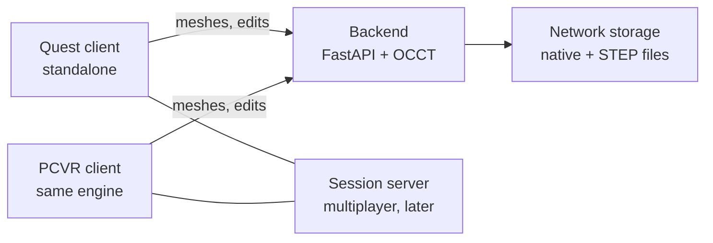

# DIDSA VR Design Tools: Vision Brief

Sep 24, 2026 · @John

> Point-in-time export (as of 26 Sep 2026, rev 23) of a live Claude Docs
> artifact — this file does not update automatically when the live doc
> changes. Ask John for the current artifact link if this looks stale, and
> re-export after any significant change to keep the repo in sync.

## Vision

DIDSA VR Design Tools is a shared VR/XR workspace where engineers build assemblies, model parts and run flat-screen apps at real-life scale. It joins the DIDSA Design Tools family, reuses the DIDSA-CAD backend and opens the same native files. Meta Quest standalone is the primary target, with a PCVR option for models too heavy for the headset.

The author is a mechanical design engineer, not a software developer, so Claude acts as developer and advisor on this project.

## Platforms and constraints

The goal is device-agnostic, but Quest has the market, so Quest comes first and its limited onboard compute shapes everything else.

| Platform | Role | Note |
| --- | --- | --- |
| Quest 2, 3, 3S (standalone) | Primary target | Sideloaded APK; limited compute, so the headset only displays and interacts |
| PCVR | Heavy models | Same client and native files, or a sibling app on the same engine |
| Pico, Steam Frame, Galaxy | Later | Reachable if the client stays on OpenXR |
| Apple | Later, separate effort | Different platform; do not design around it yet |

Models must be imported over a network from storage the user already has, so the network path matters as much as the headset.

## Proposed architecture

Proposal, not yet confirmed against the repo: a thin VR client that displays and manipulates meshes, with all geometry work on the DIDSA-CAD backend.

The headset never runs OCCT; it receives tessellated geometry (glTF is the likely format) and sends back edits and mate commands. PCVR uses the same client with more headroom.

The Flutter client will not carry over because it cannot drive a VR view. The VR client needs an OpenXR-capable engine, with Unity and Godot as the realistic candidates. The engine is the first decision, since it fixes language, tooling and platform reach.

**Payload, measured.** On a test assembly of 186 instances of 4 unique parts, the current JSON assembly-mesh is 470 KB and the existing flattened glb is 1.33 MB. A node-instanced glTF is estimated at 90 to 100 KB. Decision: one glTF scene per call.

**Storage.** Assembly composition moves into the backend, which reads project files from a mounted network share, so clients need no file-system access. The backend already speaks plain HTTP on a LAN; the Quest app needs a scoped cleartext exception in its Android network config, or TLS.

## Reuse from DIDSA-CAD

The backend is the main reuse candidate; the client code is not. Two repo recons on 24 September 2026 confirmed this.

| Piece | Reuse | Finding |
| --- | --- | --- |
| Import, tessellate, export and solve endpoints | Yes, as-is | Plain JSON over HTTP with no Flutter coupling; import already accepts STEP, STL, OBJ and glTF |
| Assembly scene (assembly-mesh) | Yes, plus a glTF encoder | Already deduplicated per part with world transforms; the encoder needs no new geometry work |
| Solvers (py-slvs) | Yes | Mate solve is backend logic; v1 drives one occurrence against fixed peers |
| Single-file native format | Yes | One Part per file, owned by the backend |
| Multi-file assembly composition | Port to Python | Client-side Dart today; a simple graph walk that gets easier on the server |
| Local sketch solver (Dart/FFI) | No | Exists for drag speed; VR either reimplements it or solves on release |
| Mate picking | Ids yes, code no | face and edge ids are engine-agnostic; picking is a raycast in the VR client |
| Flutter rendering and UI | No | Cannot drive a VR view |

Sources: docs/vr-recon-2026-09-24.md and docs/vr-recon-2-2026-09-24.md in the DIDSA-CAD repo.

## Interaction model

Four manipulation modes, each usable on its own and switchable from the wrist tablet.

1. **Model movement.** One hand grabs to move the model around the user. Two hands grab to rotate and scale.
2. **User movement.** Physical walking; left thumbstick walks and strafes; right thumbstick rotates and teleports. Teleport blinks forward by the indicated distance on thumbstick release.
3. **Individual part manipulation.** Laser-target a part and select with the trigger. Grab translates it, thumbstick rotates it, A/B move it nearer or further.
4. **Scale views.** Jump to real-life size or pick from a list of scales for small and large objects, with an option to lock to the chosen scale.

A popup keyboard opens on a click of the right thumbstick, everywhere, for any text entry.

## Tools, wrist tablet and mates

A wrist-mounted tablet controls the environment: UI and UX settings, tool selection and menus.

**Assembly tools**

- Relax all mates and enforce all mates buttons.
- Shoot to hide: with the tool active, laser-target a part and fire to hide it.
- Reverse visible and hidden state of all parts.
- Interactive tree with sub-assemblies and parts that can be pulled out into world space or onto the design table.
- Colours, sections and measurements.
- Import parts from network storage into the assembly.

**Mates workflow**

1. Start the mates tool on the wrist tablet.
2. Laser-target faces and edges.
3. Pick the mate type from the wrist menu.
4. Type any values on the popup keyboard.

**Cross-app compatibility with DIDSA-CAD (flat), added 27 Sep 2026 — not yet
in the live doc, see `docs/status.md`'s "Vision brief drift" note.** Mates
created in VR must be readable and editable in DIDSA-CAD's flat app, and
vice versa, so a user can move between VR and flat and take the same
assembly file with them. Mates are already backend/session state, not
client state (see "Reuse from DIDSA-CAD" above: "Mate picking: Ids yes, code
no — face and edge ids are engine-agnostic; picking is a raycast in the VR
client" and "Solvers (py-slvs): Yes — Mate solve is backend logic"), so this
should fall out for free as long as the VR client's mates tool is built as a
client to the *same* backend Mate create/solve endpoints the flat app uses,
rather than inventing a separate VR-only representation. Worth a compatibility
check against a real flat-created assembly once mates are built, not just
against VR-created ones.

## In-VR part modelling

The user stays in the assembly arena and a floating design table appears in front of them. Sketches are drawn on the flat table and the part geometry floats above it, with modelling tools in menus around the table.

- **AI-assisted modelling.** Describe the part by microphone or text, or draw it on an easel; the image is saved and pushed to the existing AI modelling tool from inside VR.
- **Physical pen (open question).** Whether a Bluetooth pen on a real table could drive sketching on the virtual drawing board, and whether that needs new hardware.

Part modelling already exists in DIDSA-CAD, so the VR version should call the same modelling backend rather than reimplement it.

## Multiplayer and environments

Several people share one environment. Each can walk or move around the model, set up their own part design table and crate, and add new parts to the common assembly.

Multi-user comes in two stages.

**Stage 1, shared files.** Clients share one Part per file on network storage, with the backend composing assemblies. Users editing different Parts never collide. Today two users saving the same file overwrite each other whole-file, so the first safeguard is a version check on write that rejects a stale save. Two people actively editing one assembly file still need a lock or check-out.

**Stage 2, live presence.** Seeing each other's edits live needs a backend with separate session and document, persistence, a push channel and per-user identity. That is a separate backend project, scoped on its own.

Environments wanted: aircraft hangar, warehouse, open paved area, laboratory, clean room. Whether open-source versions exist is an open research question.

## Milestones

The four original milestones stand, with a recon step and an engine spike added in front.

| # | Milestone | Done when |
| --- | --- | --- |
| 0 | glTF endpoint and engine choice | Done. Backend built and merged (PR #250): GET /parts/{id}/assembly-mesh.glb, node-instanced, hidden filtered server-side by default. Engine spike (Godot 4 OpenXR core, PCVR via Virtual Desktop) succeeded end-to-end: import → glb fetch → correct-scale render → grab → locomotion. Godot is the pick. |
| 1 | Import and viewport | In progress. Native import + individual part manipulation (proximity grab, and trigger-laser select with thumbstick rotate / A-B nudge) and user movement (walk, snap-turn, teleport) are built and running on-device. Still open: whole-model two-hand rotate/scale, scale views, and STEP/glTF/OBJ/STL import (backend already exposes /parts/{id}/import-features for STEP/OBJ/STL and a bare .glb needs no backend round-trip at all). |
| 2 | Design table | A summonable drawing board where sketches on the table drive geometry floating above it |
| 3 | Floating windows | Calculator, browser, PDF reader, image viewer and DIDSA-CAD run as flat windows in the arena |
| 4 | Assembly environment | Parts move individually; mates, colours, sections and measurements work |

Shared network storage (stage 1) follows milestone 4; live presence (stage 2) is a separate backend project.

## Open decisions and risks

- [x] Engine: Godot, decided by a hands-on Quest spike (PCVR via Virtual Desktop) that imported a real assembly, fetched the assembly-mesh.glb endpoint, rendered it at correct real-world scale (mm→m), and supported grip-grab plus thumbstick locomotion — all working end-to-end. Plain Godot 4 OpenXR core, no godot-xr-tools. Standalone Quest APK export/sideload not yet tested; a formal Unity comparison was not run since no compelling functionality gap turned up.
- [x] Repo: backend stays in DIDSA-CAD; the VR client is DIDSA-UK/DIDSA-VR (private), git-initialised with a first commit covering the milestone 0/1 work so far. Backend URL and API key load from a gitignored secrets.cfg rather than being hardcoded in a script or baked into a .tscn override.
- [x] Geometry transport: node-instanced glb endpoint built and merged (PR #250). Vertex welding deferred; real payload size not yet measured against this endpoint, only estimated on the JSON endpoint.
- [ ] Backend location for a standalone Quest: a LAN server, over plain HTTP with a scoped cleartext exception in the Quest app, or TLS.
- [ ] Storage: server-side composition over a mounted network share. Roadmap placeholder added; still needs its own scoping doc superseding decisions 4 and 6 in docs/assembly-scope.md.
- [ ] Drag latency: reimplement a local solve in the VR client, or solve on release (proposed for v1).
- [ ] Window apps: how to run DIDSA-CAD and a browser as floating panels on Quest.
- [ ] Live presence: separate backend project, after shared-file storage.

**Main risk:** the size estimate (about 100 KB for 186 instances) was measured on imported meshes, not real parametric assemblies, and dragging over a network round trip may feel laggy. Test both early.

## Parked ideas

Not needed for milestone 1; revisit once the viewport works.

- Bluetooth pen for sketching on a real table (hardware question first).
- Easel drawing pushed into the AI modelling tool.
- Voice-described parts by microphone.
- Multiplayer with per-user design tables and crates.
- Environment library: hangar, warehouse, paved area, laboratory, clean room.
- Apple, Pico, Steam Frame and Galaxy builds.
